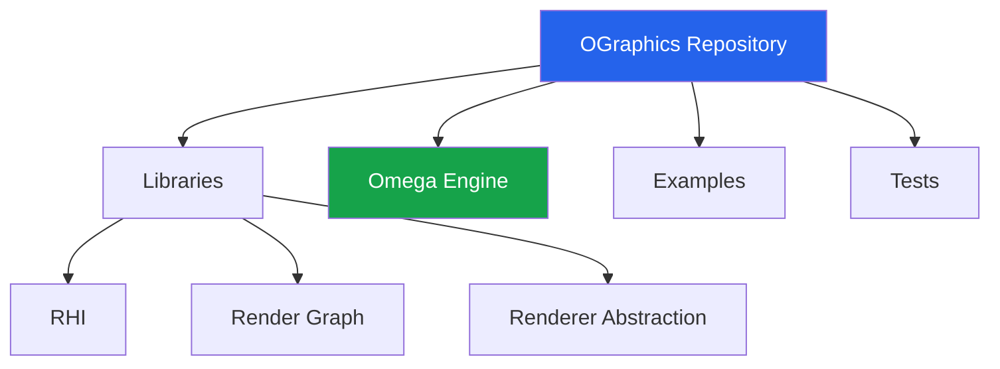
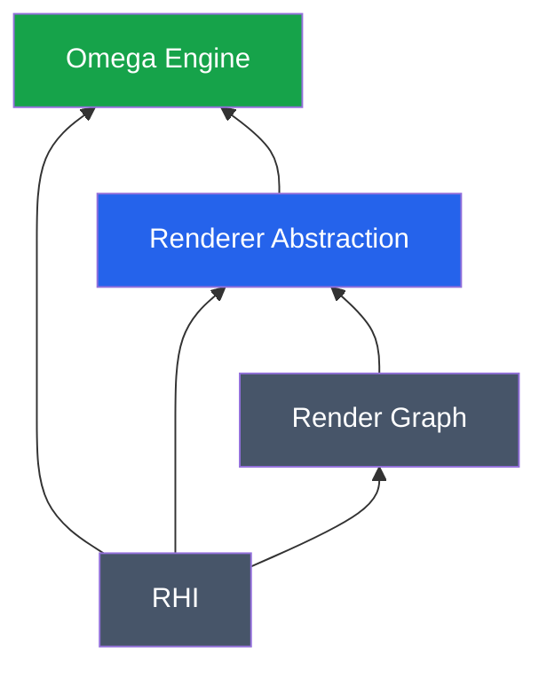
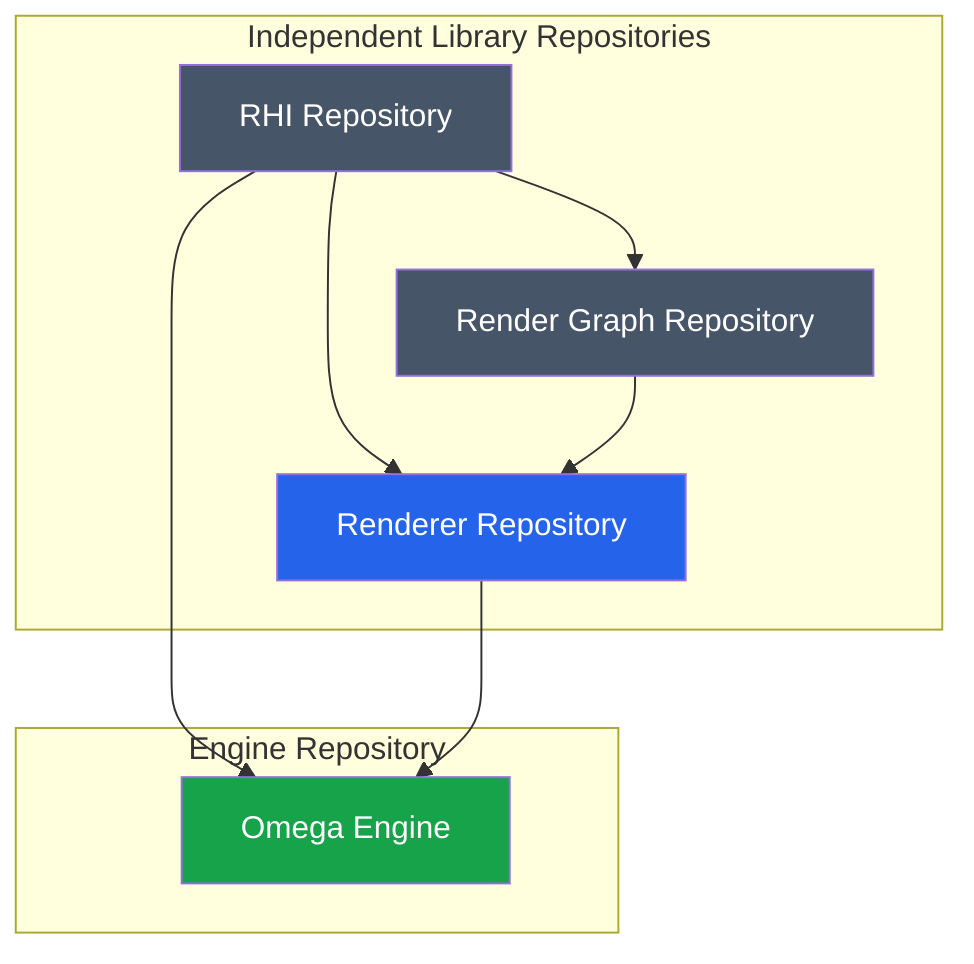

# OGraphics

OGraphics is a collection of graphics and engine-development libraries built with the goal of creating **Omega Engine**, a game and graphics engine developed from the ground up.

The idea behind the project is to build a set of reusable, independent libraries, each providing a well-defined layer of functionality on top of the previous ones. Rather than developing the engine as a single monolithic application, the goal is to establish a modular architecture where each layer can be developed, tested, and potentially reused independently.

The ultimate goal is to bring these libraries together into **Omega Engine**, progressively building higher-level systems on top of a solid graphics infrastructure.

## Repository Organization

Currently, this repository contains all the libraries developed for the project, along with code examples, tests, and the Omega Engine itself.

Keeping everything in a single repository is a deliberate decision for the early stages of development. It makes it easier to develop, integrate, test, and experiment with the different systems while their interfaces and responsibilities are still evolving.

The current repository organization can be represented as follows:

As the project matures, the plan is to split the repository into individual repositories, one for each library and for Omega Engine.

This separation reflects an important architectural principle: **each library should depend only on the layers below it, never on the layers above it.** Lower-level libraries should remain independent of the higher-level systems built on top of them, making them reusable beyond Omega Engine itself.

## Architecture

The project follows a layered architecture where individual libraries provide increasingly higher-level functionality.

At the foundation lies the **Render Hardware Interface (RHI)**, which provides the low-level abstraction over graphics APIs and hardware resources. It serves as the common graphics foundation for the other systems.

On top of it, the project builds the Render Graph and Renderer Abstraction, which provide higher-level rendering functionality. Omega Engine integrates these systems and builds upon the same underlying graphics infrastructure.

The arrows represent dependencies: higher-level systems can use lower-level libraries, but lower-level libraries do not depend on the systems built above them.

This approach aims to keep each library modular and reusable, allowing the underlying graphics infrastructure to evolve independently of the engine.

## Future Repository Structure

The current monolithic repository is intended to be a temporary development organization. Once the libraries and their interfaces become more stable, the project will move towards a multi-repository structure.

The intended organization is:

Each repository will own its respective library, including its implementation, tests, and examples. Dependencies between repositories will reflect the actual architectural relationships.

Ultimately, OGraphics is both the development space for these libraries and the foundation upon which Omega Engine is being built.
